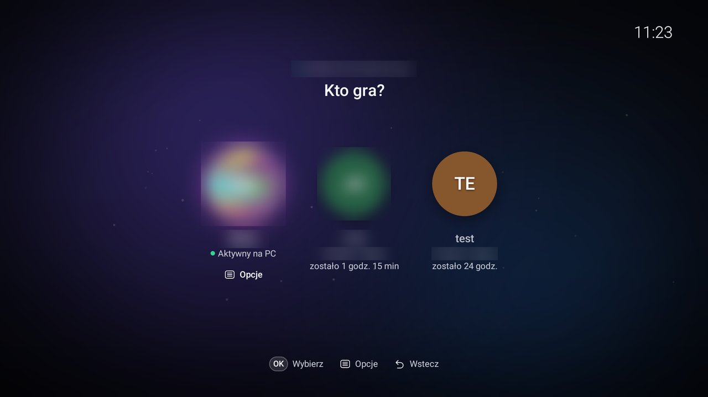
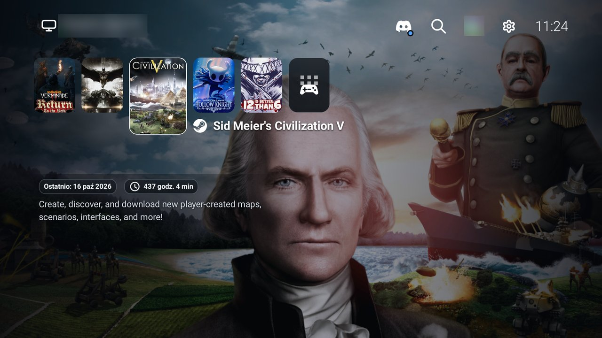
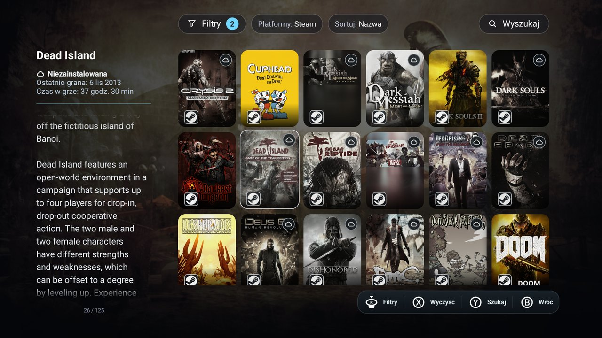
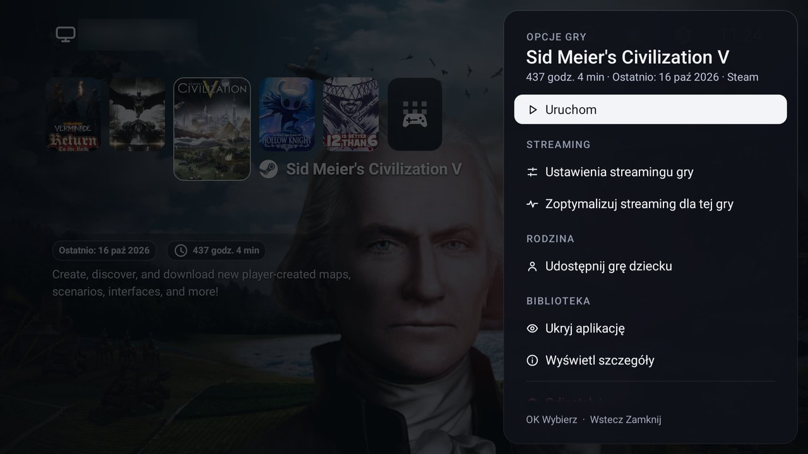
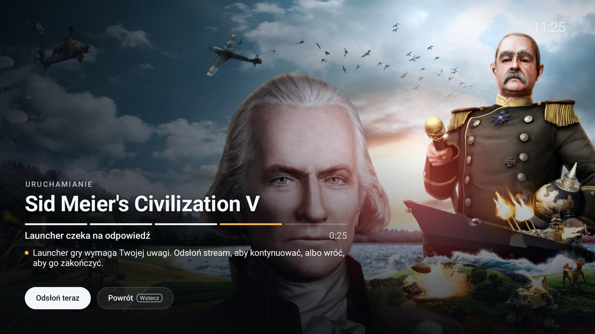

# MoonWaker

MoonWaker is an Android TV client for streaming PC games, built on
[Moonlight](https://moonlight-stream.org) and paired with its own Windows host side.

The point of it is a console on your TV. You pick up the pad, choose who plays and which
game, and the rest happens on its own: the PC wakes up, the right Windows user signs in, the
game starts and the picture shows up once the game is really there. Until then the stream
stays covered. Windows itself, with its desktop and launcher windows, is what MoonWaker works
hard to keep off the screen, and every menu is built for a remote or a gamepad from the couch.

The game library comes straight from the stores installed on the PC: Steam (owned games
through the Steam Web API, install state from Steam's own manifests) and Epic through
Legendary. Playnite is an optional third provider for games from other launchers. It is off by
default, and a host with only Steam needs nothing else.

It is a personal project under active development, not a released product. Breaking changes
between the Android app and the host services are normal: both are built and installed from
the same source revision.

## Screenshots

Names of profiles and of the host are blurred.

| | |
| --- | --- |
|  |  |
| Profile selection: an adult profile signed in on the PC and child profiles with their remaining play time. | Home screen: recent games, the host's stream state, Discord, search and settings. |
|  |  |
| The library with filters, sort and search. Each tile carries its store's badge. | Game options: launch, per-game streaming settings, sharing with a child, details. |
|  |  |
| Transition cover while the PC and the stream get ready. | The game's launcher is waiting for input. The cover says so and offers to reveal the stream now. |

## What it adds to Moonlight

- **Console UI for TV**: host and profile selection, a game library (carousel, grid,
  filters, artwork), an on-screen keyboard and controller glyphs, all usable with a remote
  or a gamepad.
- **Session lifecycle**: Wake-on-LAN, launch preflight, warm-up, remote Windows sign-in,
  Fast User Switching, suspend/resume, a stream kept alive in the background, and switching
  games without tearing down the transport.
- **Transition cover**: the stream stays covered until the expected game window is
  confirmed and a fresh video frame has been rendered. The user can reveal it by hand at
  any time, because the cover is a UX layer and makes no security promise.
- **Game operations**: install, update and uninstall from the TV, for Steam and for Epic
  through Legendary, with a durable journal on the host. The host also puts the game
  window on the streamed display and reports a missing Steam license as something to fix
  in the launcher.
- **Stream overlay**: bitrate can be changed while streaming, and the overlay shows the
  controller's battery level.
- **Profiles**: optional PIN per profile, child profiles with a parent-defined library and
  play-time limits.
- **Discord**: community panel, direct messages and voice. A USB microphone on the TV is
  passed to the host through a separate microphone worker.

## Repository layout

| Path | Contents |
| --- | --- |
| `app/` | Android application. MoonWaker code lives in `com.limelight.console`, `session`, `stream`, `gateway`, `discord` and `diagnostics`. Everything else is Moonlight. |
| `app/src/main/jni/moonlight-core/` | Upstream Moonlight streaming core (submodule `moonlight-common-c`). Kept as close to upstream as possible. |
| `host-services/` | Windows host: Gateway (the only LAN-facing API), an in-process Vibepollo client, per-profile Bridges (the game provider Agent for Steam, Epic and Playnite, and the optional Discord Bridge; the Agent's code sits in `bridges/playnite/` for historical reasons), the microphone worker, Host Control (tray app and Configurator), installer, hot updater, Login Broker and Credential Provider. See [host-services/README.md](host-services/README.md) and [docs/MoonWaker/HOST_HOT_UPDATES.md](docs/MoonWaker/HOST_HOT_UPDATES.md). |
| `lab/` | Deterministic lab runner for device scenarios. |
| `docs/` | Agent guides (`docs/agents/`), the console menu spec (`docs/MoonWaker/UX_MENU_PL.md`), host hot updates and third-party audio notices. `docs/MoonWaker/HARDENING/tools/` holds the source-fingerprint tool `lab/` uses. |

## Architecture in one paragraph

The TV talks to the host over two channels. Media goes directly to the streaming host
(Vibepollo, Sunshine-compatible) through the Moonlight core. Everything else goes through
the MoonWaker **Gateway**: pinned HTTPS, pairing, Bearer tokens and per-profile grants.
The Gateway forwards to loopback-only **Bridges** that run inside each Windows profile.
Durable game-operation state lives on the host. The Android app keeps presentation state
only. Details and ownership rules are in
[MOONWAKER_ARCHITECTURE.md](MOONWAKER_ARCHITECTURE.md) and
[docs/agents/SESSION_CONTRACTS.md](docs/agents/SESSION_CONTRACTS.md).

## Building

Requirements: JDK 17, Android SDK (compile SDK 34) with NDK 27.0.12077973, Python 3 and
Windows PowerShell for the host services.

```bash
git submodule update --init --recursive
```

Create `local.properties` in the repository root with `sdk.dir=` pointing at the Android
SDK.

Android debug APK (`nonRoot` is the normal flavor):

```bash
./gradlew assembleNonRootDebug
```

The Discord features need the Discord Social SDK, which is a licensed binary and is not in
the repository. Place it in `local-sdk/discord-social-sdk-1.10.18687` or pass
`-PdiscordSocialSdkDir=<path>`. Without it the build leaves Discord disabled.

Host installer (runs the host test suites as part of the build, output in
`host-services/dist`; add `-WithDiscord` to include the optional Discord Bridge):

```powershell
powershell.exe -NoProfile -ExecutionPolicy Bypass -File .\Build-HostServices.ps1
```

## Testing

```bash
./gradlew testNonRootDebugUnitTest
```

```bash
python -m unittest discover -s host-services/gateway -p 'test*.py'
```

```bash
python -m unittest discover -s host-services/bridges/playnite -p 'test*.py'
```

```bash
python -m unittest discover -s lab -p 'test*.py'
```

These are unit tests. Anything that claims a working stream, Windows sign-in or real input
needs a run on a device. See [docs/agents/VALIDATION.md](docs/agents/VALIDATION.md) for
which checks are safe to run locally and which touch a real host or TV.

## Working on the code

- [AGENTS.md](AGENTS.md): the rules every change has to follow.
- [CODEX_WORKFLOW.md](CODEX_WORKFLOW.md): how delegated tasks and reviews are run.

## Upstream and credits

MoonWaker is a fork of
[MoreOrLessSoftware/moonlight-android](https://github.com/MoreOrLessSoftware/moonlight-android)
(branched at v0.4.10), which is itself a fork of
[Moonlight Android](https://github.com/moonlight-stream/moonlight-android) by Cameron Gutman
and contributors, with changes from
[Artemis](https://github.com/ClassicOldSong/moonlight-android).

Licensed under the GNU General Public License v3. See [LICENSE.txt](LICENSE.txt). Third-party
attributions are in [NOTICE](NOTICE) and
[docs/THIRD_PARTY_AUDIO.md](docs/THIRD_PARTY_AUDIO.md).
